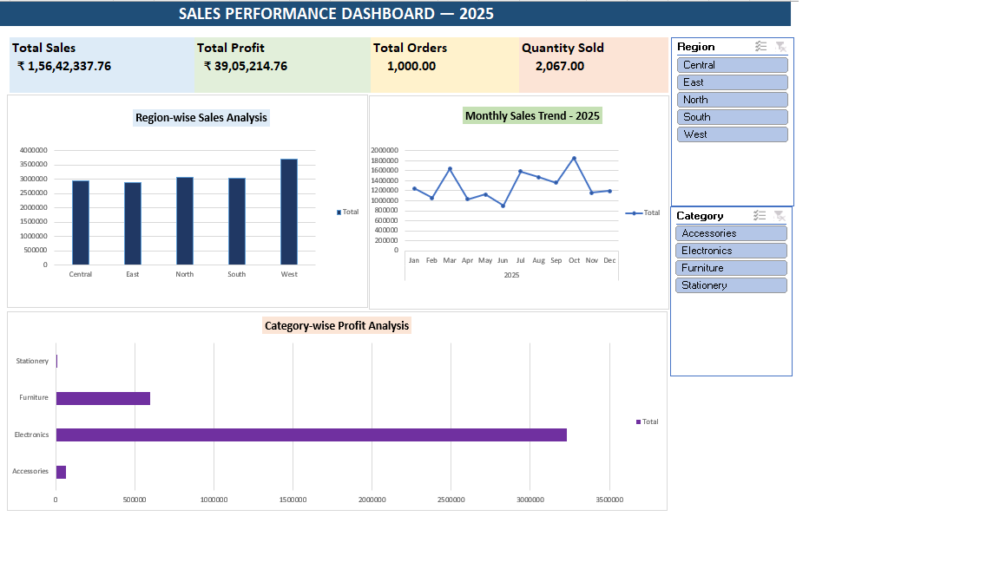

# Excel Sales Analytics Dashboard

## Tools Used
- Microsoft Excel
- Pivot Tables
- Pivot Charts
- Slicers
- KPI Cards

## Dashboard Features
- Monthly Sales Analysis
- Region-wise Sales
- Category-wise Profit
- Interactive Filters
- Sales and Profit KPIs

## Purpose
To analyze sales performance and visualize business insights using an interactive Excel dashboard.

## Dashboard Preview

  
