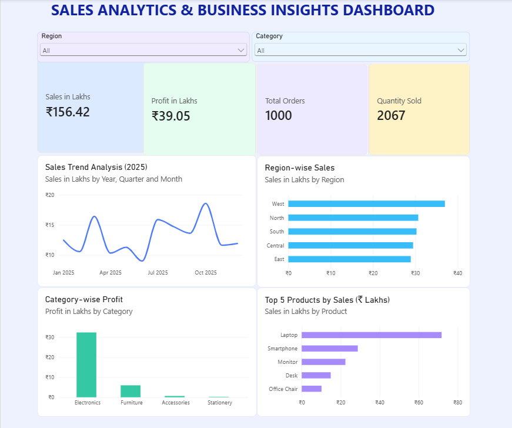
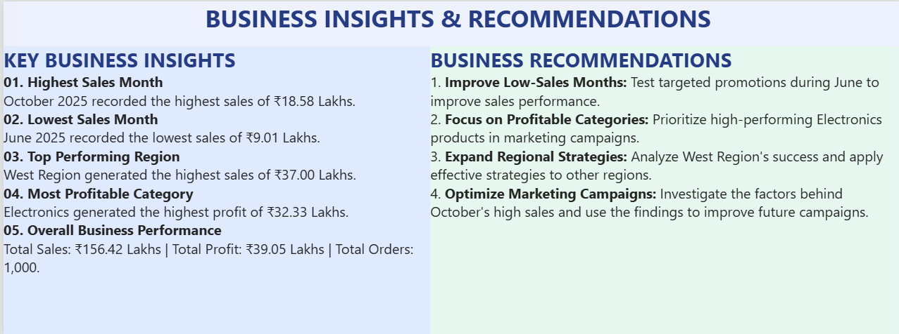

# Power BI Sales Analytics Dashboard

## Tools Used
- Microsoft Power BI
- Power Query
- DAX
- Interactive Data Visualization

## Dashboard Pages
1. Sales Analytics Dashboard
2. Business Insights

## Dashboard Features
- Total Sales, Profit, Orders and Quantity KPIs
- Monthly Sales Trends
- Region-wise Sales Analysis
- Category-wise Profit Analysis
- Top 5 Products
- Interactive Slicers
- Business Insights and Recommendations

## Purpose
To analyze sales performance, identify trends,
and support data-driven business decisions
using Power BI.
  

## Dashboard Preview

### 1. Sales Analytics Dashboard

### 2. Business Insights Dashboard

  
